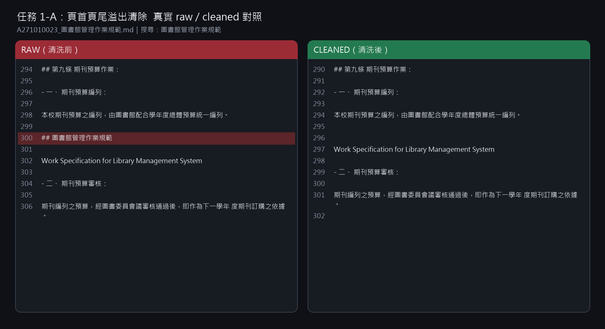
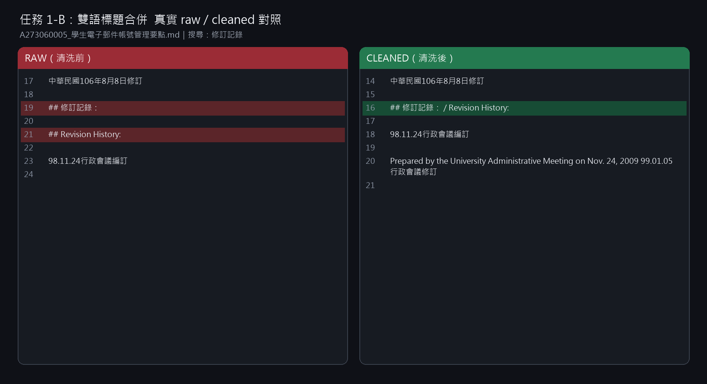
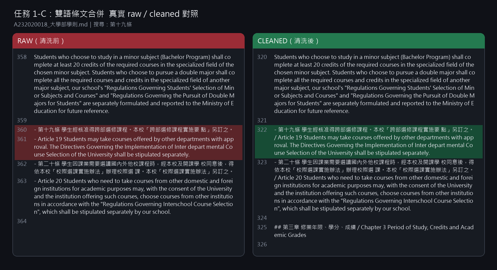
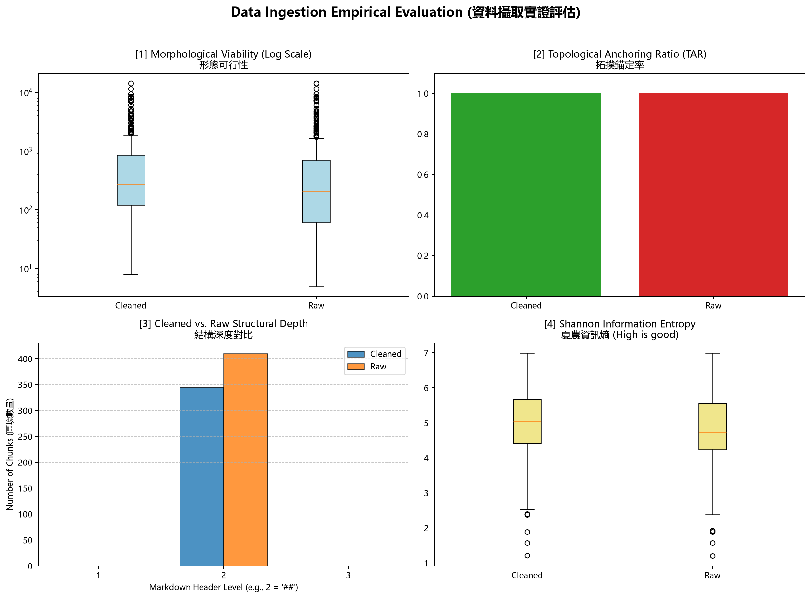

# 資料前處理報告 (Data Preparation Report)

- **學號 / 姓名**：U12627020/張峻毓
- **專案名稱**：-nlp-mcut-qa-system
- **完成的任務**：- [x] 1-A 頁首頁尾清除　- [x] 1-B 雙語標題合併　- [x] 1-C 雙語條文合併

---

## 1. 資料集概覽 (Dataset Overview)

| 類別 (Cluster) | PDF 數量 | 清洗前 chunk 數 | 清洗後 chunk 數 |
|---|---|---|---|
| Academic_Affairs | 3 | 96 | 65 |
| Library_Information | 3 | 248 | 225 |
| Student_Affairs | 3 | 66 | 55 |
| **合計** | **9** | **410** | **345** |

**問題 (2–3 句)：** 清洗後 chunk 數量變少了多少？是哪個任務造成的？有沒有哪個任務**不影響** chunk 數量？為什麼？

清洗後由 410 個降為 345 個，共減少 65 個。1-A 移除以 `##` 開頭的重複頁首頁尾，1-B 將相鄰的中英文 `##` 標題合併，因此都會減少依 `\n(?=##\s)` 切出的 chunks；1-C 只合併同一標題下的中英文條文清單項，不新增或刪除 `##` 標題，所以不影響 chunk 數量。

## 2. 清洗步驟 (Cleaning Steps)

### 2.1 任務 1-A：頁首頁尾溢出清除

- 檔名：`A271010023_圖書館管理作業規範.pdf`　搜尋的文字：`圖書館管理作業規範`
- 截圖 (存為 `reports/figures/1a_compare.png`)：
- 改變了什麼：raw 第 300 行重複出現的 `## 圖書館管理作業規範` 頁首被移除，前後的「期刊預算編列」與「期刊預算審核」內容重新連續。
- 這對之後的問答檢索有什麼幫助：避免重複頁首被誤當成新的 chunk 標題，減少只有頁首或主題被切斷的檢索結果。
- 這個任務有沒有**改錯**的地方 (把不該改的也改了)？若有，寫出檔名與搜尋的文字；若沒有，寫「沒有發現」：沒有發現。

### 2.2 任務 1-B：雙語標題合併

- 檔名：`A273060005_學生電子郵件帳號管理要點.pdf`　搜尋的文字：`修訂記錄`
- 截圖 (存為 `reports/figures/1b_compare.png`)：
- 改變了什麼：raw 第 19、21 行分開的 `## 修訂記錄：` 與 `## Revision History:`，在 cleaned 第 16 行合併為 `## 修訂記錄： / Revision History:`。
- 這對之後的問答檢索有什麼幫助：中英文標題與其修訂內容會留在同一個 chunk，使用中文或英文查詢時都能取回完整脈絡。
- 這個任務有沒有**改錯**的地方 (把不該改的也改了)？若有，寫出檔名與搜尋的文字；若沒有，寫「沒有發現」：沒有發現。

### 2.3 任務 1-C：雙語條文合併

- 檔名：`A232020018_大學部學則.pdf`　搜尋的文字：`第十九條`
- 截圖 (存為 `reports/figures/1c_compare.png`)：
- 改變了什麼：raw 第 360、361 行原為兩個獨立清單項目的第十九條中文與 Article 19 英文，在 cleaned 第 322 行以 ` / ` 合併成同一條文。
- 這對之後的問答檢索有什麼幫助：同一條規定的中英文不會分散在不同位置，能降低只取回單一語言或缺少對照內容的情況。
- 這個任務有沒有**改錯**的地方 (把不該改的也改了)？若有，寫出檔名與搜尋的文字；若沒有，寫「沒有發現」：沒有發現。

## 3. 評估指標與 AI 解讀查證 (Metrics & Verifying the AI's Interpretation)

### 3.1 指標數據表

| 指標 | Raw | Cleaned (你的) | Cleaned (參考值) |
|---|---|---|---|
| [1] 中位數長度 Median Length | 204.0 | 272.0 | 272.0 |
| [2] 拓撲錨定率 TAR | 100.00% | 100.00% | 100.00% |
| [3] 深度變異量 SDV (選填) | 0.00 | 0.00 | 0.00 |
| [4] 中位數資訊熵 Entropy (選填) | 4.7149 | 5.0484 | 5.0484 |



你的 Cleaned 結果與參考值一致嗎？若一致，寫「一致」；若不一致，找出原因。（1 句）

一致。

### 3.2 AI 的解讀

- 使用的 AI 工具：ChatGPT / Codex

```text
儀表板顯示，清洗後的 chunk 數量雖然減少，但典型 chunk 變得較長：中位長度由 204 提高到 272，符合相鄰雙語標題與條文被合併的結果。Raw 與 Cleaned 的 TAR 都是 100%，表示清洗沒有破壞以 Markdown 標題作為 chunk 錨點的結構。SDV 都是 0，代表目前所有 chunk 使用相同的標題深度；這是切塊規則只以 ## 標題切分的結果，不代表原始文件沒有階層。資訊熵中位數由 4.7149 提高到 5.0484，顯示典型 cleaned chunk 的字元分布較豐富、重複程度較低，但中位數不能排除少數超長或低熵的表格與表單異常值。
```

### 3.3 你的查證 (至少兩點)

**查證 1**
- AI 的說法：清洗合併相鄰雙語結構後，chunk 數會下降、典型 chunk 會變長，而且不會破壞標題錨點。
- 我查了什麼 (哪個檔案、哪個 chunk、哪段程式)：查 `metrics.json` 的 raw／cleaned 數量與中位長度，並比對 `raw_A232020018_大學部學則.md` 第 360–361 行和 cleaned 第 322 行的第十九條。
- 結論：正確，因為 chunk 數由 410 降為 345、中位長度由 204 升為 272，TAR 仍為 100%，且第十九條中英文確實合併在同一個 `##` 標題範圍內。

**查證 2**
- AI 的說法：資訊熵中位數提高不代表每一個 chunk 都良好，仍可能存在低熵的表格或表單異常值。
- 我查了什麼：查 `cleaned_A232060013_學生抵免學分辦法.md` 第 277 行的指定 chunk；它長 4,367 字元、熵為 3.06，`□准予抵免` 重複 8 次、`核簽流程` 重複 10 次。
- 結論：正確，因為這張申請表的大量空白欄位、核取方塊與重複簽核文字明顯低於 cleaned 中位資訊熵 5.0484。

### 3.4 實際證據：你被指定的 chunk

- **SEED**：1106

**(a) 很長的 chunk**
- 資料檔 (JSON)：`data/processed/Academic_Affairs/cleaned_A232020018_大學部學則_processed.json`　位置：第 9 個 (從 0 開始數)　長度：7304 字元　驗證碼：`b5e1784a`
- 閱讀用檔案 (`.md`)：`data/interim/Academic_Affairs/cleaned_A232020018_大學部學則.md`　從第 501 行開始
- 前 3 行內容：
  ```text
  ## 第四章 請假、休學、復學、退學 / Chapter 4 Excused Absences Leaves of Absence (Suspension), Resumption of Studies, and Withdrawal

  - 第四十三條 學生因故不能上課，須依照請假規則辦理請假，經核准請假者為缺課（公假除外），未請假或請假未准而未上課者為曠課。「學生請假作業辦法」另訂之。 / Article 43 Students who are unable to attend class are required to request a leave in accordance with the Regulations Governing Student Leave Requests.
  ```
- 這是什麼樣的文字？為什麼會這麼長？這是大學部學則第四章的雙語法規，包含第四十三條至第五十二條，主題涵蓋請假、休學、復學與退學。現行切塊只在下一個 `## ` 標題出現時分段，章內的「第…條／Article n」不是 `##` 標題，因此十條規定都留在同一個 chunk。
- 之後做問答檢索時，這麼長的 chunk 可能造成什麼問題？一次取回 7,304 字元會混入多個不同問題的規定，使 embedding 主題被稀釋、答案定位困難，並增加模型的上下文與推論成本。

**(b) 資訊熵很低的 chunk**
- 資料檔 (JSON)：`data/processed/Academic_Affairs/cleaned_A232060013_學生抵免學分辦法_processed.json`　位置：第 25 個 (從 0 開始數)　資訊熵：3.06　驗證碼：`f2c4c2f8`
- 閱讀用檔案 (`.md`)：`data/interim/Academic_Affairs/cleaned_A232060013_學生抵免學分辦法.md`　從第 277 行開始
- 內容：
  ```text
  ## 明 志 科 技 大 學 學 分 抵 免 申 請 書 Ming Chi University of Technology Credit Transfer Application Form

  - [ ] □博士班 □碩士班 □四技部

  | 系所(學位學程)   | 班 級   | 姓 名   | 學 號   | 申 請 日 期   |
  |------------------|---------|---------|---------|---------------|

  請依照抵免科目依序填寫

  | 抵       | 擬抵免科目(請依課程總表)   | 擬抵免科目(請依課程總表)   | 擬抵免科目(請依課程總表)   | 擬抵免科目(請依課程總表)   | 已修科目(原校修得)   | 已修科目(原校修得)   | 審查結果                                                                                                                                                             | 審查結果                                                                                                                                                             | 審查結果                                 |
  |----------|----------------------------|----------------------------|----------------------------|----------------------------|----------------------|----------------------|----------------------------------------------------------------------------------------------------------------------------------------------------------------------|----------------------------------------------------------------------------------------------------------------------------------------------------------------------|------------------------------------------|
  | 免 順 序 | 學 年 \ 期                 | 學 分 數                   | 科目代號                   | 科目名稱                   | 學 年 \ 期           | 學 分 數 科目名稱    | 以少抵多註明應補修科目及學分數， 不足學分數需補修科目需與抵免科目有相關性                                                                                            | 以少抵多註明應補修科目及學分數， 不足學分數需補修科目需與抵免科目有相關性                                                                                            | 任課老師 (無則系級單位主 管)審查結果簽名 |
  |          |                            |                            |                            |                            |                      |                      | □准予抵免 □科目名稱及內容均相同 □科目名稱不同而內容相同 □科目名稱及內容不同但實質內涵相同 □以少抵多(補修科目/學分數)： / □以少抵多(經教務會議專案審查通過) □不准抵免 | □准予抵免 □科目名稱及內容均相同 □科目名稱不同而內容相同 □科目名稱及內容不同但實質內涵相同 □以少抵多(補修科目/學分數)： / □以少抵多(經教務會議專案審查通過) □不准抵免 |                                          |
  |          |                            |                            |                            |                            |                      |                      | □准予抵免 □科目名稱及內容均相同 □科目名稱不同而內容相同 □科目名稱及內容不同但實質內涵相同 □以少抵多(補修科目/學分數)： / □以少抵多(經教務會議專案審查通過) □不准抵免 | □准予抵免 □科目名稱及內容均相同 □科目名稱不同而內容相同 □科目名稱及內容不同但實質內涵相同 □以少抵多(補修科目/學分數)： / □以少抵多(經教務會議專案審查通過) □不准抵免 |                                          |
  |          |                            |                            |                            |                            |                      |                      | □准予抵免 □科目名稱及內容均相同 □科目名稱不同而內容相同 □科目名稱及內容不同但實質內涵相同 □以少抵多(補修科目/學分數)： / □以少抵多(經教務會議專案審查通過) □不准抵免 | □准予抵免 □科目名稱及內容均相同 □科目名稱不同而內容相同 □科目名稱及內容不同但實質內涵相同 □以少抵多(補修科目/學分數)： / □以少抵多(經教務會議專案審查通過) □不准抵免 |                                          |
  |          |                            |                            |                            |                            |                      |                      | □准予抵免 □科目名稱及內容均相同 □科目名稱不同而內容相同 □科目名稱及內容不同但實質內涵相同 □以少抵多(補修科目/學分數)： / □以少抵多(經教務會議專案審查通過) □不准抵免 | □准予抵免 □科目名稱及內容均相同 □科目名稱不同而內容相同 □科目名稱及內容不同但實質內涵相同 □以少抵多(補修科目/學分數)： / □以少抵多(經教務會議專案審查通過) □不准抵免 |                                          |
  | 核簽流程 | 核簽流程                   | 核簽流程                   | 核簽流程                   | 核簽流程                   | 核簽流程             | 核簽流程             | 核簽流程                                                                                                                                                             | 核簽流程                                                                                                                                                             | 核簽流程                                 |
  | 教務長   | 教務長                     | 教務長                     | 教務長                     | 副教務長                   | 註冊組長             | 註冊組承辦人         | 院級單位主管                                                                                                                                                         | 系級單位主管                                                                                                                                                         | 系級單位承辦人                           |
  ```
- 為什麼它的資訊熵這麼低？它對問答檢索有用嗎？它是空白申請表，包含大量相同的審查選項、空白儲存格與簽核欄位，因此字元分布高度重複而使資訊熵偏低。欄位名稱仍可回答「抵免申請需要什麼資料」，所以有部分用途；但應保留原表供稽核，另將重複模板正規化後再送入檢索。

## 4. 一個尚未解決的問題 (One Remaining Problem)

- **檔名** (`cleaned_*.md`)：`cleaned_A271010023_圖書館管理作業規範.md`　**從第 1757 行開始** (VS Code 左側的行號)　**標題**：`Attachment 5 / Comparison Table of Unit Recommendation Points in Database`
- **我是怎麼找到的** (例如：搜尋了什麼、看了哪個檔案)：我在 cleaned chunks 中依長度與資訊熵檢查異常值，再到 Library_Information 的 cleaned Markdown 搜尋 `Attachment 5`，確認該 chunk 不是第 3.4 節的兩個指定 chunks。
- **問題 chunk (貼上部分內容)**：

```text
## Attachment 5 / Comparison Table of Unit Recommendation Points in Database

| | | Number of Databases Recommended by X Unit - 1 2 | Number of Databases Recommended by X Unit - 3 | Number of Databases Recommended by X Unit - 4 | ... |
|---|---|---|---|---|---|
| | 1 | 140 140 | 140 | 140 | ... |
| | 2 | 112 | 112 | 112 | ... |
| | Sort 5 | | | 28 | ... |
| | Sequence 7 | | | 15 | ... |
```

- **問題是什麼**：寬度很大的比較表被轉成一個 14,350 字元的 chunk，欄名重複、空白儲存格很多，`Sort / Sequence / of / Y` 等原本的直向標籤也被拆散，表格語意難以閱讀。
- **可能的原因** (PDF 本身？Docling 轉換？清洗的正則表示式？切塊規則？)：PDF 原表格跨多欄且有合併儲存格，Docling 轉成 Markdown 時無法完整保留版面；切塊規則又只看下一個 `## `，沒有針對大型表格設定長度上限。
- **具體的修正方法** (例如：一條規則、一個正則表示式的構想、長度上限)：辨識 Markdown 表格後使用 table-aware chunking，依欄群或列群切分，設定約 1,200–1,500 字元上限；每個子 chunk 重複保留附件標題、欄名與來源 metadata，並保留原始 Markdown 供核對。
- **對問答檢索的影響**：重複欄名與空白值會主導 embedding，使用者查詢資料庫推薦點數時可能取回整張難以閱讀的長表，而不是與指定單位或排名相關的精確列。

## 5. AI 協作 (AI Collaboration)

- 本次作業的 AI 協作紀錄請見 [`AI_USAGE.md`](AI_USAGE.md) 的「Week 04 / 08」與「Week 09」段落。
- 這次使用 AI 最大的收穫或教訓是提示詞必須明確指定「真實檔案、行號，並排除 Notebook 範例」；第一次選圖碰到模板禁止的示例文字，回到 raw／cleaned Markdown 逐行核對後，才改用圖書館規範第 300 行與「修訂記錄」的真實案例。
