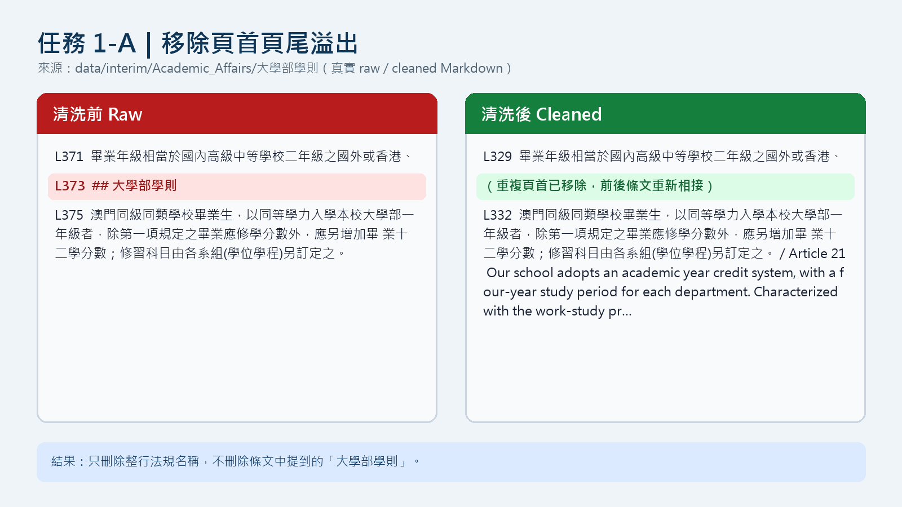
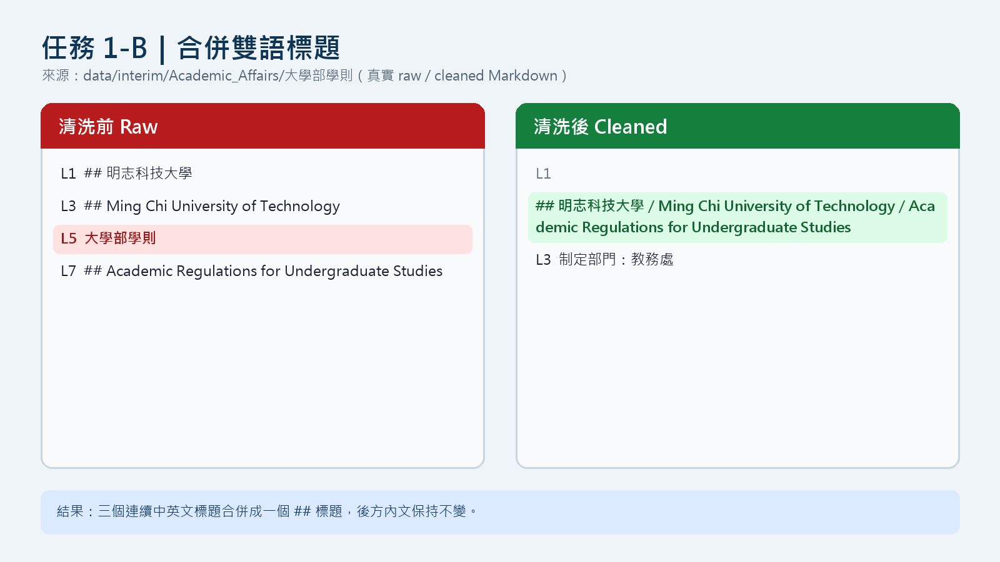
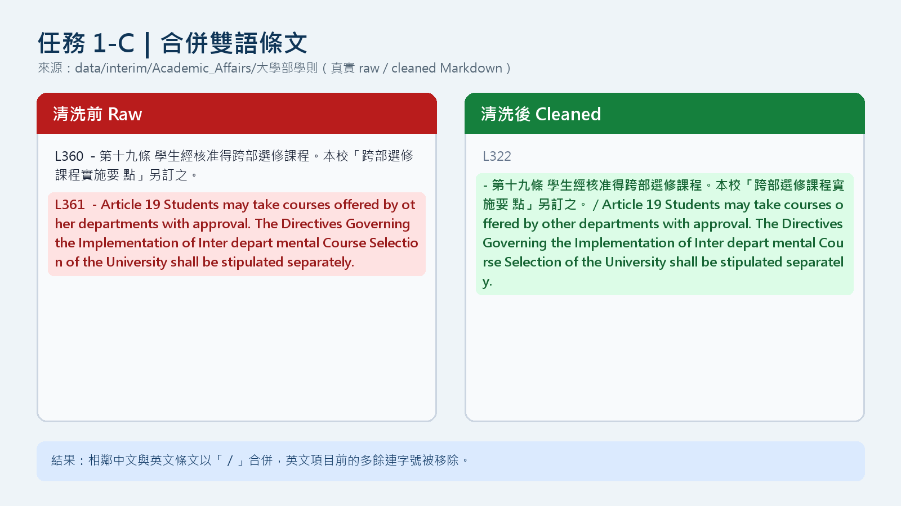

# Week 09 期中資料前處理報告

- **學號／姓名：** U12627020／張峻毓
- **指定參數：** SEED `1106`
- **資料狀態：** 2026-11-04 以本機 9 份校規 PDF 完成資料前處理；2026-11-06 執行 `09_midterm_chunks.ipynb` 取得個人指定 chunks。

> 原始 PDF、`data/interim/` Markdown 與 `data/processed/` JSON 依課程規定只留在本機；GitHub 僅提交報告、圖檔、AI 紀錄與保留輸出的 Notebook。

## 1. 資料集概覽

資料管線以 `data/raw/<類別>/*.pdf` 的父資料夾作為分類標籤，先由 Docling 轉成 Markdown，再依序執行頁首頁尾清除、雙語標題合併、雙語條文合併，最後以 Markdown `##` 標題切成 chunks。

| 類別 | PDF 數量 | Raw chunks | Cleaned chunks |
|---|---:|---:|---:|
| Academic_Affairs | 3 | 96 | 65 |
| Library_Information | 3 | 248 | 225 |
| Student_Affairs | 3 | 66 | 55 |
| **合計** | **9** | **410** | **345** |

Notebook 第 5 節顯示 9 份 PDF 全部成功解析、錯誤 0；第 5.1 節對 410 筆 raw 與 345 筆 cleaned records 逐筆檢查 `text`、來源檔名、類別、字元長度、標題與 chunk 類型，共 **755 筆 schema 驗證通過**。清洗後 chunks 從 410 減為 345，主要是雙語標題與條文由分離區塊合併成同一語意單位。

## 2. 清洗步驟（1-A／1-B／1-C）

### 2.1 任務 1-A：頁首頁尾溢出清除

程式從檔名 `A232020018_大學部學則.pdf` 動態取得「大學部學則」，只移除整行等於法規名稱的重複頁首。下圖的 raw 第 373 行把第二十一條切斷；cleaned 版本移除該頁首後，香港與澳門的條文重新相接。內文若只是提到「大學部學則」則不會被刪除。

### 2.2 任務 1-B：雙語標題合併

Raw Markdown 將校名與英文法規名稱拆成多個連續 `##` 標題。清洗後只保留第一個 `##`，其餘英文標題以 ` / ` 接在同一行；制定部門等後續內文維持原順序，沒有被吞入標題。

### 2.3 任務 1-C：雙語條文合併

Raw 第十九條的中文與英文分成兩個清單項目。清洗後以 ` / ` 合併為同一條文，並移除英文項目前多餘的 `- `；這讓中英內容在同一個 chunk 中，降低跨語言檢索時只找到單一語言的風險。

三項課堂斷言均輸出 `[Success]`。這證明指定正例與反例通過；實際批次品質仍以下列統計與指定 chunk 人工查證為準。

## 3. 評估指標與 AI 解讀查證

### 3.1 Raw／Cleaned 指標

| 評估指標 | Raw | Cleaned | 觀察 |
|---|---:|---:|---|
| Morphology Median Length | 204.0 | 272.0 | 合併後典型 chunk 較長 |
| Topological Anchoring Ratio（TAR） | 100.00% | 100.00% | 所有 chunks 都以 Markdown 標題錨定 |
| Structural Depth Variance（SDV） | 0.00 | 0.00 | 本管線的 chunk 標題皆為 `##` |
| Shannon Median Entropy | 4.7149 | 5.0484 | cleaned 中位資訊熵較高 |

### 3.2 AI 的兩個解讀

1. **AI 說法一：** 清洗合併了相鄰的雙語結構，因此 chunk 數會下降，而典型 chunk 長度會提高；只要標題仍被保留，TAR 不應下降。
2. **AI 說法二：** cleaned 的資訊熵中位數提高，表示典型 chunk 的字元分布較不重複、資訊較豐富；但中位數改善不能代表每一個 chunk 都良好，表格或表單仍可能是低熵異常值。

### 3.3 回到自己的檔案查證

| AI 說法 | 查證證據 | 結論 |
|---|---|---|
| 說法一 | 全資料 raw／cleaned 為 410／345；中位長度 204／272；TAR 皆為 100%。`A232020018_大學部學則` 單檔也由 43 降為 21 chunks，且第 2 節可直接看到標題與條文確實被合併。 | **成立。** 數量與實際文字變化方向一致，而且標題錨點沒有流失。 |
| 說法二 | 資訊熵中位數由 4.7149 升至 5.0484；但個人指定的學分抵免申請表 chunk 熵只有 3.06，內容包含大量重複欄位、空格與核取方塊。 | **成立但需保留條件。** 整體典型值改善，仍不能忽略低熵表單異常。 |

### 3.4 個人指定的兩個 chunks

`09_midterm_chunks.ipynb` 使用學號 `U12627020` 與 SEED `1106`，從 9 個 cleaned JSON、345 個 chunks 中指定下列兩筆：

| 類型 | 來源與位置 | 長度／熵／排名 | 驗證碼 |
|---|---|---|---|
| 很長的 chunk | `data/interim/Academic_Affairs/cleaned_A232020018_大學部學則.md` 第 501 行；JSON 第 10 個物件（position 9） | 7,304 字元／5.46／最長候選第 11 名 | **`b5e1784a`** |
| 低資訊熵 chunk | `data/interim/Academic_Affairs/cleaned_A232060013_學生抵免學分辦法.md` 第 277 行；JSON 第 26 個物件（position 25） | 4,367 字元／3.06／低熵候選第 18 名 | **`f2c4c2f8`** |

#### 3.4.1 很長的 chunk：第四章請假、休學、復學、退學

我從第 501 行讀到下一個 `##` 標題，完整內容涵蓋第四十三條至第五十二條。這些條文主題都屬學籍異動，因此章節層級具有一致性；但單一 chunk 同時包含請假、休學年限、服役、復學、勒令休學、退學、開除學籍與證明文件等多個可獨立回答的問題，7,304 字元會造成檢索後的上下文過長與主題稀釋。

造成超長的直接原因是目前只用 `\n(?=##\s)` 切分；章內的「第四十三條」到「第五十二條」不是 `##` 標題，所以全部留在同一 chunk。人工閱讀也發現解析瑕疵：第四十六條的「服役期間」被拆成新的 `- ` 清單項；第五十條英文第十款附近出現 `5. any of the reasons...` 的錯誤編號；第五十二條中文亦被不必要的連字號切開。較好的做法是辨識 `第…條`／`Article n` 的雙語配對，在保留第四章標題為 metadata 的同時，改成一條或少數相關條文一個 chunk，並設定長度上限。

#### 3.4.2 低資訊熵 chunk：學分抵免申請表

我從第 277 行讀到下一個 `##` 標題，內容是一張「學分抵免申請書」。它不是一般敘述性法規，而是含大量空白儲存格、核取方塊、重複審查選項與核簽流程的表單。完整 chunk 中 `□准予抵免` 出現 8 次、`核簽流程` 出現 10 次；重複字串拉低資訊熵，也使 4,367 字元中有大量內容對語意檢索幫助有限。

這筆資料仍有保存價值，例如回答「抵免申請需要哪些欄位」；但目前 Markdown 表格把相同審查欄位展開兩次，空白列也被當作文本。較好的做法是將表單辨識為 `content_type=form`：保留標題、欄位名稱、審查選項與簽核角色各一次，空白填寫列改為結構化欄位，不把重複模板直接送入語意向量。

## 4. 一個尚未解決的問題

### 問題：表格／表單仍被當成一般長文本切塊

低熵指定 chunk 長 4,367 字元，是 cleaned 中位長度 272 的約 **16.1 倍**；熵 3.06 也比 cleaned 中位數 5.05 低約 **1.99**。這不是 1-A、1-B、1-C 正則可以解決的問題，而是 chunker 沒有區分法規段落與表格／表單結構。

影響包括：

- 重複選項與空白列主導 embedding，真正的欄位語意被稀釋。
- 查詢「抵免審查結果」可能取回 4,367 字元整張空表，而不是精簡的申請欄位或審查規則。
- 大型表格容易超過後續模型理想上下文，並增加儲存及推論成本。

建議修正流程：

1. 以 Markdown 表格符號密度、核取方塊及重複列判斷 `content_type=table/form`。
2. 保留原始 Markdown 供稽核，另建立正規化版本：欄位名稱、審查選項、簽核角色各保留一次。
3. 依邏輯區段或 1,200–1,500 字元上限切分；每個子 chunk 繼承來源、表單標題與頁面／列範圍。
4. 空白填寫列不送入 embedding，但不能從原始資料永久刪除。

修正後的驗證標準是：所有可見欄位名稱都能在正規化資料找到；`□准予抵免` 等模板只存一次；最大 chunk 明顯低於 4,367 字元；schema 仍通過；用「抵免申請欄位」與「審查結果」兩個查詢進行人工檢索測試。此改動尚未套用，因為本次期中先忠實報告現有管線的缺陷。

## 5. AI 協作

完整提示詞與驗證紀錄見 [AI_USAGE.md](AI_USAGE.md)。本週使用 Codex 協助整理課堂規格、製作真實 raw／cleaned 對照圖、提出兩項指標解讀，以及檢查指定 chunks 的結構問題；所有數字都回到 Notebook 輸出、JSON 與指定 Markdown 行號核對，沒有用示範值代替實測。

AI 第一次建立 1-A 圖時選到同檔案較前面的同名標題，而不是第二十一條中間的頁首；我以 raw 第 371–375 行重新核對後，改用第 373 行的實際溢出位置。這次經驗顯示：AI 能快速整理與提出解讀，但相同文字在文件中可能出現多次，最後仍必須用來源檔、行號、驗證碼與完整 chunk 做人工查證。

**一句話收穫：** 我學到指標只能指出「哪裡可能有問題」，真正判斷清洗品質仍要回到自己的原始文字與指定 chunk。
